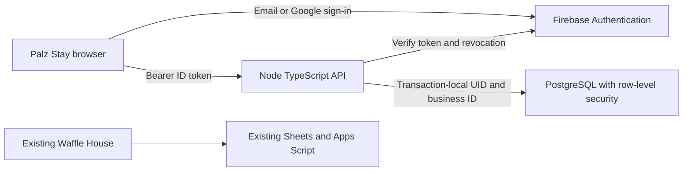

# As-built: commercial foundation v0.1

Built 18 October 2026. Scope: an independently runnable local slice of Palz Stay, coexisting with the Waffle House prototype. This describes implemented code, not a promise of public production readiness.

## Runtime and trust boundaries

Local identity is the loopback-only `demo-palz-stay` Auth emulator. Local PostgreSQL is PGlite running on the **server**, never in the browser. Production mode instead requires a dedicated Firebase project, HTTPS origin and PostgreSQL URL. That mode fails closed if an emulator is configured. No dedicated cloud resources have been provisioned or billed.

The new source sits under `_platform/`; Jekyll excludes it from the GitHub Pages website. CI builds the actual Pages artifact and asserts `_site/_platform` does not exist. Existing Waffle bootstrap, Care, service worker and live API are untouched. There is no account gate added to Waffle House and no data sync/migration bridge.

## Components

| Path | Responsibility |
|---|---|
| `web/` | Firebase SDK sign-in, verification, workspace picker, dogs/owners, bookings, team and export |
| `src/server.ts` | Startup validation, static asset allowlist, exact Host guard, security headers and HTTP limits |
| `src/auth.ts` | Firebase Admin ID-token verification with revocation check, correct issuer/audience and emulator restrictions |
| `src/api.ts` | Verified-email authorization, body/field validation, current-user-derived identity, safe errors and rate limits |
| `src/database.ts` | Transactional store, active membership checks, local PGlite or production `pg` pool |
| `migrations/001_initial.sql` | Tables, scoped foreign keys, RLS policies, narrow bootstrap functions and booking guards |
| `tests/` | Adversarial API/SQL checks, real Auth integration, production adapter and browser journeys |

Build with `npm ci && npm run build`; the output is `public/` plus `dist/server.js`. A deployment can then prune dev dependencies and start `node dist/server.js`, retaining migrations and the production packages. No TypeScript runner or Firebase CLI is required in the production process.

Node 24, TypeScript ESM, Firebase browser/Admin SDKs, PostgreSQL and esbuild. The lockfile pins dependencies. The production dependency override for grpc-js addresses the audit findings present during implementation; audit is checked again in CI.

## Identity and privacy

Firebase verifies the person's account; database membership authorizes the business. All private calls verify the ID token and require verified email. The API obtains UID from the token, ignores supplied role/plan/UID, and checks active business membership on every transaction. Owner-only functions are team management and export; staff can read dogs/owners/bookings and add dogs/bookings.

Invitations contain 32 random bytes, expire after seven days, store only SHA-256 token hashes, require matching verified email and are single-use. The UI removes invite query credentials before config/Firebase network operations. It only creates a link; it never sends an invitation email. Revoke staff by disabling membership; their already-issued token cannot authorize the next request. Previously downloaded data cannot be remotely recalled.

Private responses are `no-store`; the browser has no service worker or persistent private data cache. Firebase uses in-memory persistence. Session/workspace epochs discard delayed responses after logout or workspace switch. A content security policy disallows inline scripts/styles and third-party fonts. No contact details, credentials or tokens are written by application logging. Local Firebase emulator verification links are development credentials and must stay private.

## Data model and isolation

All durable IDs are UUIDs except Firebase user IDs. Dogs also have a distinct sequential number **within their business**; #00001 in two separate businesses is intentional. Names are display values, never identity keys. A dog can participate in multiple bookings without a new dog ID.

| Table | Key relationships |
|---|---|
| businesses | Unique slug, timezone, dog capacity, Free plan |
| members | Business + Firebase UID, owner/staff and active/disabled |
| owners | Business-scoped pet owner contact |
| dogs | Business, owner, per-business number |
| bookings | Business, inclusive start/end dates and mutation intent |
| booking_dogs | Composite tenant foreign keys to booking and dog |
| invites | Business, normalized email, hashed token and expiry |
| audit_events | Business, authenticated actor, event and minimal object IDs |

RLS requires an active membership and the selected business context for private tables. Business discovery and self-membership discovery are deliberately permitted without a selected workspace. Each transaction sets UID/business with `SET LOCAL`; pooled connections cannot inherit the previous request's identity. Local PGlite serializes whole transactions because it has one underlying connection. Production uses a pool of at most ten connections.

The application connects as `palz_app`, never the table owner, superuser or BYPASSRLS role. Startup also rejects CREATE ROLE, CREATE DATABASE and inherited role privileges. RLS is not FORCE because narrow migration-owner SECURITY DEFINER functions create initial membership and accept invitations; their authenticated-user checks and fixed `pg_catalog,public,pg_temp` search paths are tested, including temporary-table shadowing. The API remains the trusted identity boundary: database context must never be set directly by an untrusted browser/client.

Bookings are atomic across up to eight dogs. A transaction locks the business to serialize capacity checks; inclusive date overlap for the same dog is rejected. A same-intent mutation retry returns the existing booking; a changed intent with that key returns conflict. Dates range from 2000–2100, at most 366 inclusive days. Capacity 1–200 is a validation bound, not certified scale. Same-day bookings consume capacity for that day; back-to-back arrival on the checkout day currently overlaps deliberately.

Pilot guardrails: 50 dogs/business, three active team members including the owner, and at most three owned businesses/account. These are **initial test limits**, not the agreed final Free/Plus/Pro packaging. They do not replace public-registration abuse controls or fleet-wide usage budgets.

## Production preparation (not activated)

1. Select dedicated free-tier pilot Firebase, PostgreSQL and Node hosting resources and verify their current quotas/eligibility before creating them. Keep existing Waffle resources separate. Do not enable paid billing automatically.
2. Configure Firebase email/password and Google providers, approved domains, verification/reset templates and separate Admin credentials or workload identity. Test real email and Google popup flows; emulator tests do not validate deliverability or production consent screens.
3. Apply the SQL migration once to an empty dedicated database with a separate migration-owner credential. The runtime does not auto-migrate production. Provision `palz_app LOGIN` with a generated secret through the provider's secure administration channel; never commit or log it. Do not grant table ownership, extra role membership or BYPASSRLS. If a free provider cannot support the required role setup, adapt/review that boundary before deploying.
4. Supply environment variables from `.env.example` through secret management. Use TLS with certificate validation for remote database connections, private networking where offered, least-privileged credentials and pool budgets across instances. The generic `pg` adapter does not configure a particular provider's TLS/CA policy.
5. Deploy API and its bundled browser assets together on the configured exact HTTPS origin. Behind a proxy preserve that Host; forwarded headers are not trusted. Add edge rate limiting and per-account quotas before public signup. The in-process IP limiter (120/minute, bounded buckets) is a local safeguard, not distributed abuse protection.
6. Complete restore drills, retention/deletion, private files, owner access, monitoring/redaction, incident response, load tests and billing entitlement tests before public launch. No production hosting manifest is supplied yet because the provider is undecided.

## Costs and scale

This implementation runs locally and uses synthetic CI services, so it adds no cloud infrastructure subscription. Existing repository CI allowances still apply. It does **not** guarantee a free production service or performance for 600 businesses / 10,000 concurrent users. Current reads return a bounded dog directory but all bookings; pagination, reporting indexes, query budgets, connection pooling at the hosting boundary and measured load tests are required before scale claims.

Use one shared application and tenant-scoped database rather than deploying 600 copies. Start with one app host and a workspace selector. Slugs reserve stable business addresses; wildcard DNS/subdomains such as `<business>.palzstay.com` are a later routing/branding feature, subject to domain ownership and verified membership. A hostname must never substitute for authorization.

The planned tiers remain Free $0 / Plus AUD $10 / Pro AUD $30. No subscriptions, payment webhooks or paid entitlements are implemented. Before pricing launch, measure per-tenant database/storage/email usage and support costs, model taxes/payment fees, and define hard tier limits. Do not promise unlimited usage against free-tier infrastructure.

Development-tool audit at implementation: Firebase CLI transitives have seven advisory findings (four moderate, three high); none are in the production dependency set. The CLI is used only for loopback synthetic Auth emulation, never for untrusted project builds or public deployment. Do not use an unreviewed forced downgrade to resolve them; recheck upstream before expanding CLI use.
